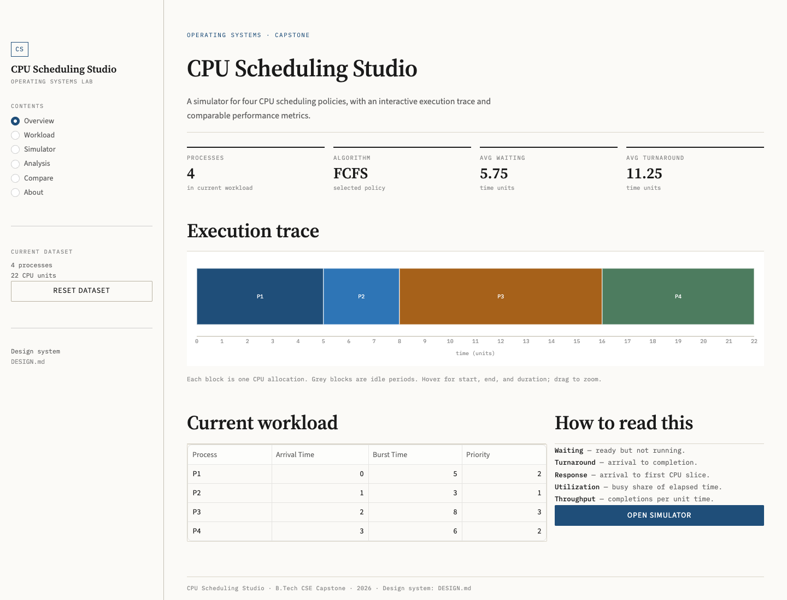
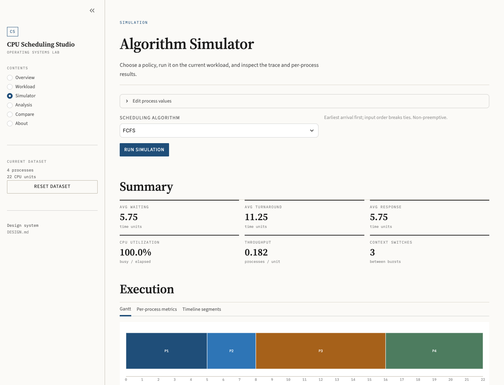
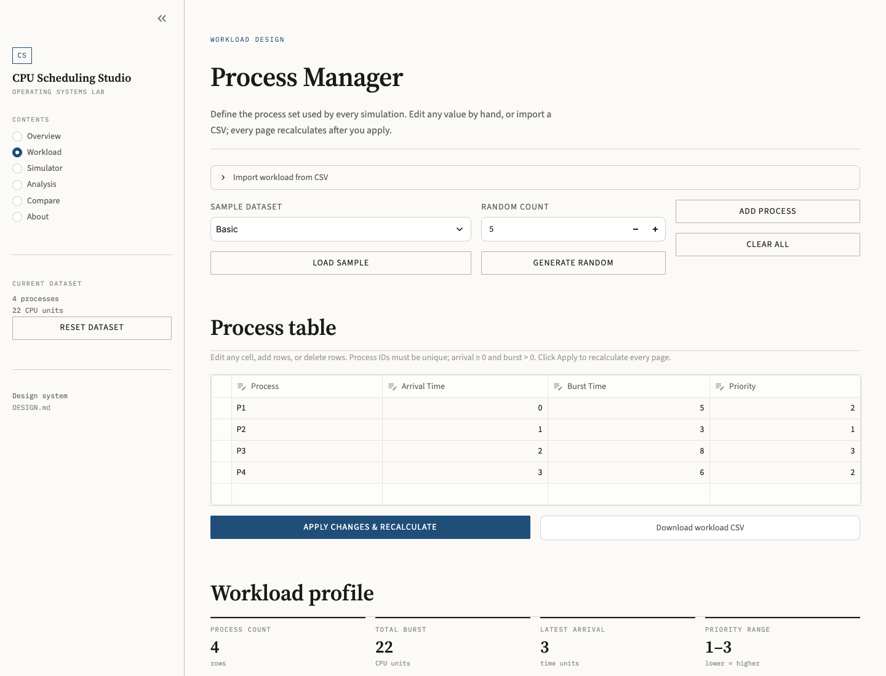
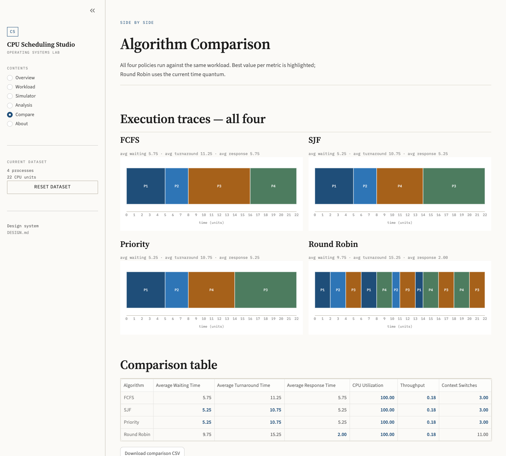

# CPU Scheduling Studio

[](https://github.com/aaneya/CPU_Scheduling_Visualizer/actions/workflows/ci.yml)

An interactive **Streamlit** dashboard for learning and comparing CPU scheduling policies. Edit a process workload by hand, run all four algorithms, inspect each execution on a **Plotly Gantt timeline**, and compare real performance metrics side by side.

## Quick start
```bash
streamlit run app.py
```
Then open `http://localhost:8501`.

## Features

- **Editable workload** — edit any cell, add or delete rows, load a sample, generate randomly, or import/export CSV. Click **Apply changes & recalculate** to update every page.
- **Run all four in one click** — produces four Gantt charts, averages, and a comparison table for the same workload.
- **Four correct schedulers**:
  - FCFS (First Come First Served) — non-preemptive
  - SJF (Shortest Job First) — non-preemptive
  - Priority — non-preemptive (lower number = higher priority)
  - Round Robin — preemptive, configurable time quantum
- **Interactive Gantt chart** — hover timing, zoom, pan, per-process colors, idle CPU blocks.
- **Per-process metrics** — completion, turnaround, waiting, response times.
- **System metrics** — CPU utilization, throughput, burst vs. elapsed time, context switches.
- **Algorithm comparison** — all policies on the same workload, best value per metric highlighted, four Gantt traces, per-process tables, and CSV downloads.
- **Metric explanations** — student-friendly guide for every term.
- **Tested** — 14 pytest cases covering traces, idle CPU, validation, and metrics; GitHub Actions CI on every push.
- **Academic interface** — paper-white surfaces, hairline rules, serif headings, monospace data, single navy accent. No gradients or template chrome.
- **Six focused pages** — Overview, Workload, Simulator, Analysis, Compare, About.

## Screenshots

| Overview | Algorithm Simulator |
|---|---|
|  |  |

| Process Manager | Algorithm Comparison |
|---|---|
|  |  |

## Technology

| Layer | Technology |
|-------|-----------|
| UI / Dashboard | Streamlit |
| Charts | Plotly |
| Data | Pandas, NumPy |
| Language | Python 3.10+ |

## Design

The interface follows a **technical / academic** direction: it should read like a well-set lab handout, not a SaaS landing page. Visual hierarchy comes from typography and spacing — serif headings, monospace numerals, hairline rules, and one navy accent. The Gantt chart is the visual centrepiece.

The full token set, component rules, and references (Tufte CSS, Distill.pub, Our World in Data, Observable, Linear, Grafana, arXiv) live in [`DESIGN.md`](DESIGN.md).

## Project structure

```text
CPU_Scheduling_Visualizer/
├── app.py                      # Streamlit dashboard (all pages + CSS)
├── DESIGN.md                   # Design system: tokens, type, components
├── requirements.txt            # Python dependencies
├── requirements-dev.txt        # + pytest for local/CI tests
├── README.md                   # This file
├── .gitignore                  # Git ignore rules
├── .github/
│   └── workflows/ci.yml        # pytest on push / PR
├── .streamlit/
│   └── config.toml             # Light academic theme tokens
├── docs/
│   └── screenshots/            # Overview, workload, simulator, compare
├── tests/
│   ├── test_algorithms.py      # FCFS/SJF/Priority/RR traces + validation
│   └── test_metrics.py         # WT/TAT/RT, utilization, switches
├── assets/                     # Brand assets (logo.png)
├── algorithms/                 # Scheduling engine
│   ├── __init__.py             # ALGORITHMS registry
│   ├── _common.py              # Input validation + non-preemptive core
│   ├── fcfs.py                 # First Come First Served
│   ├── sjf.py                  # Shortest Job First
│   ├── priority.py             # Priority scheduling
│   └── round_robin.py          # Round Robin (preemptive)
└── utils/                      # Metrics + visualization
    ├── __init__.py
    ├── metrics.py              # WT / TAT / RT / CPU / throughput / switches
    └── gantt_chart.py          # Plotly Gantt figure
```

## Install & run

```bash
# 1. Clone / unzip this folder
cd CPU_Scheduling_Visualizer

# 2. Create a virtual environment
python -m venv .venv

# macOS / Linux
source .venv/bin/activate
# Windows
# .venv\Scripts\activate

# 3. Install dependencies
pip install --upgrade pip
pip install -r requirements.txt

# 4. Run the dashboard
streamlit run app.py
```

Streamlit prints a local URL, normally `http://localhost:8501`.

## Usage

1. **Workload** — edit the process table by hand (PID, arrival, burst, priority), add/delete rows, load a sample, generate randomly, or import a CSV. Click **Apply changes & recalculate**.
2. **Simulator** — open **Edit process values** to change the workload inline, pick a policy (set the quantum for Round Robin), and run. Click **Run all four algorithms** to generate all four Gantt traces and the comparison table at once.
3. **Analysis** — per-process timing and CPU-time distribution for the selected policy.
4. **Compare** — four Gantt traces, the comparison table with best values marked, per-process tabs, and CSV downloads.
5. **About** — policy definitions and metric formulas.

Included datasets cover a basic workload, same arrival times, separated arrivals with idle CPU, and a Round Robin demonstration.

## Tests

```bash
pip install -r requirements-dev.txt
pytest -q
```

The suite covers exact FCFS/SJF/Priority/Round Robin traces, idle-CPU gaps, input validation, per-process metrics, utilization, and context switches. CI runs it on every push via `.github/workflows/ci.yml`.

## Metrics & formulas

| Metric | Formula |
|--------|---------|
| Turnaround Time | Completion − Arrival |
| Waiting Time | Turnaround − Burst |
| Response Time | First execution start − Arrival |
| CPU Utilization | CPU busy time ÷ total simulation time × 100 |
| Throughput | Completed processes ÷ total simulation time |
| Context Switches | Direct transitions between different process IDs (idle excluded) |

## Teammate roles (3-member capstone group)

| Role | Responsibility |
|------|----------------|
| **Student 1 — Core / OS Implementation** | `algorithms/` (fcfs, sjf, priority, round_robin), `_common.py` validation, edge cases |
| **Student 2 — Interface & Visualization** | `app.py` pages/layout/CSS, `utils/gantt_chart.py`, Plotly charts, screenshots |
| **Student 3 — Testing & Performance** | `utils/metrics.py` correctness, test datasets, README, live-demo script, GitHub CI |

## Future improvements

- Preemptive SJF (Shortest Remaining Time First) and aging for priority.
- Workload import/export as CSV + downloadable comparison reports.
- More datasets + an instructional step-through mode.

## Repository description

Interactive Streamlit CPU scheduling simulator with Gantt charts and algorithm performance comparison for operating systems students.
